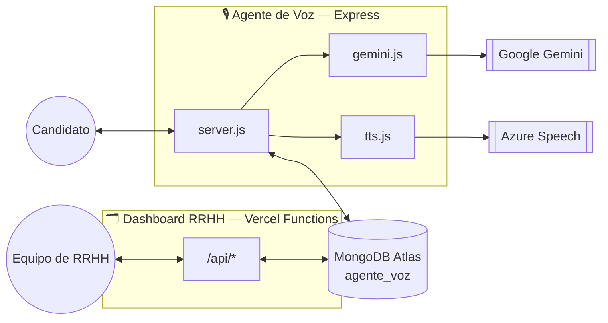
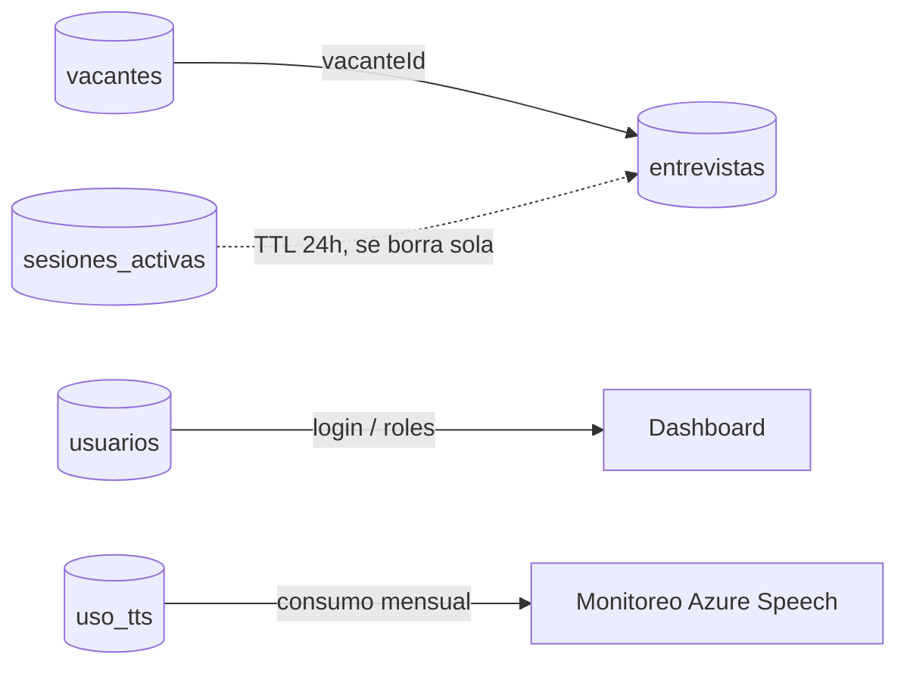
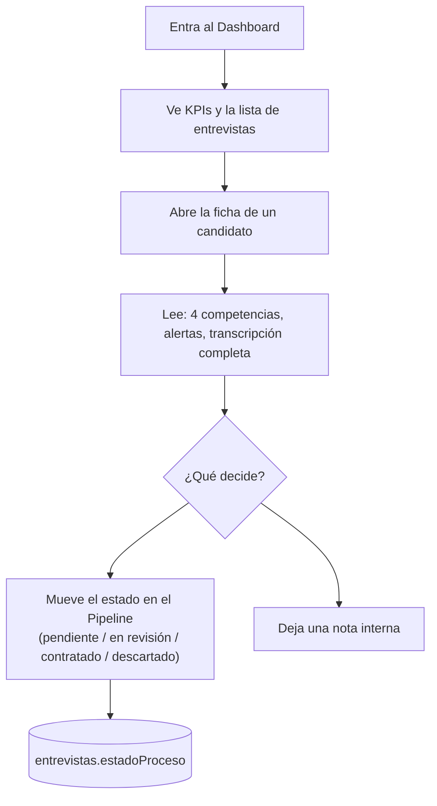

# H-AI-R — Guía de arquitectura

> Documento de referencia interno: cómo están construidas las dos aplicaciones del ecosistema
> H-AI-R, cómo se hablan entre sí, y qué hace cada archivo. Escrito para leerse sin ser
> desarrollador — los diagramas y recorridos van primero, el detalle técnico después.
>
> Este mismo archivo vive espejado en los dos repos (`agente-voz H-AI-R` y `dashboard H-AI-R`)
> porque documenta el ecosistema completo, no solo uno de los dos. Si algo cambia en el código,
> este documento puede quedar desactualizado — ante la duda, el código es la fuente de verdad.

## Contenido

1. [Vista general](#1-vista-general)
2. [La base de datos compartida](#2-la-base-de-datos-compartida)
3. [Agente de Voz — Frontend](#3-agente-de-voz--frontend)
4. [Agente de Voz — Backend](#4-agente-de-voz--backend)
5. [El "cerebro": cómo piensa el entrevistador](#5-el-cerebro-cómo-piensa-el-entrevistador)
6. [Dashboard RRHH — Frontend](#6-dashboard-rrhh--frontend)
7. [Dashboard RRHH — Backend](#7-dashboard-rrhh--backend)
8. [Seguridad, sesiones y roles](#8-seguridad-sesiones-y-roles)
9. [Recorrido: una entrevista de principio a fin](#9-recorrido-una-entrevista-de-principio-a-fin)
10. [Recorrido: RRHH revisa un candidato](#10-recorrido-rrhh-revisa-un-candidato)
11. [Variables de entorno y servicios externos](#11-variables-de-entorno-y-servicios-externos)
12. [Mapa de archivos](#12-mapa-de-archivos)
13. [Glosario](#13-glosario)

---

## 1. Vista general

H-AI-R son **dos aplicaciones separadas** que comparten una sola base de datos. Cada una tiene su
propio código, su propio hosting y su propia audiencia — pero conversan todo el tiempo a través de
MongoDB.

**🎙️ Agente de Voz** — el entrevistador. La cara pública: el candidato entra, elige una vacante,
habla, y una IA lo entrevista en tiempo real. Vive en `agente-voz H-AI-R/`, corre en su propio
servidor Express.

**🗂️ Dashboard RRHH** — el panel interno. De uso exclusivo del equipo de RRHH: gestiona vacantes,
revisa entrevistas, mueve candidatos por un pipeline. Vive en `dashboard H-AI-R/`, se despliega en
Vercel.

Ninguna de las dos aplicaciones sabe realmente que la otra existe a nivel de código — no se llaman
directamente ni comparten un servidor. Lo único que las conecta es que ambas leen y escriben en las
mismas colecciones de **MongoDB Atlas**. El agente de voz crea entrevistas; el dashboard las lee,
las enriquece con notas y estado de proceso, y administra las vacantes que el agente de voz
consume.



> **Por qué separarlos así:** el candidato nunca necesita (ni debería poder) ver el panel de RRHH,
> y RRHH nunca interactúa con el entrevistador de voz. Mantenerlos como dos aplicaciones
> independientes significa que cada una se puede desplegar, romper o mejorar sin arriesgar a la
> otra.

---

## 2. La base de datos compartida

Todo vive en un solo clúster de MongoDB Atlas, dentro de una base llamada `agente_voz`, con cinco
colecciones. Ninguna colección le pertenece a un solo microservicio — ambos leen y escriben según
lo que necesitan.



| Colección | La crea | Para qué sirve |
|---|---|---|
| `vacantes` | 🗂️ Dashboard | Las posiciones abiertas. RRHH las crea/edita/cierra aquí; el agente de voz solo las lee para armar el selector de vacantes y el plan de entrevista. |
| `entrevistas` | 🎙️ Agente de Voz | El resultado final de cada entrevista: transcripción completa, evaluación de la IA (puntaje, 4 competencias, fortalezas), y las alertas antitrampa. El dashboard la lee y le agrega `estadoProceso` y `notas`. |
| `sesiones_activas` | 🎙️ Agente de Voz | Una entrevista *en curso* — se borra sola si el candidato la abandona (índice TTL de 24h) o se elimina a propósito en cuanto termina y ya quedó guardada en `entrevistas`. |
| `usuarios` | 🗂️ Dashboard | Las cuentas del equipo de RRHH que usa el dashboard (no los candidatos). Guarda el rol de cada persona: `admin` o `reclutador`. |
| `uso_tts` | 🎙️ Agente de Voz | Un contador propio de cuántos caracteres se han sintetizado con Azure Speech este mes, para vigilar el límite del plan gratuito. |

---

## 3. Agente de Voz — Frontend

Una sola pantalla que cambia de estado: elegir vacante → entrevista en curso → terminada.
Construida en React + Vite. No hay páginas ni rutas — es una máquina de estados.

### Los 5 estados de la entrevista

Todo `App.jsx` gira alrededor de una variable de estado (`appState`) que solo puede valer una de
estas cinco cosas, y que decide qué animación tiene el orbe y qué botones están activos:

```
idle       → esperando que el candidato toque el orbe
listening  → escuchando (Web Speech API, continuous = true)
thinking   → esperando la respuesta de Gemini
speaking   → leyendo en voz alta la respuesta del entrevistador
done       → entrevista terminada
```

### Hooks — la lógica reutilizable

| Archivo | Qué hace |
|---|---|
| `useSpeechRecognition.js` | Micrófono → texto (STT), usando la Web Speech API del navegador. Escucha sin parar hasta que el candidato vuelve a tocar el orbe — no corta por pausas cortas. |
| `useSpeechSynthesis.js` | Texto → voz (TTS): intenta primero Azure Speech vía el servidor, y cae al sintetizador del navegador si Azure no está disponible. |
| `useTabVisibility.js` | Cuenta en silencio cuántas veces el candidato cambió de pestaña/ventana durante la entrevista — la señal antitrampa que ve RRHH después. |
| `useTheme.js` | Tema claro/oscuro, recordado entre sesiones. |

### Componentes visuales

`VacanteSetup` (elegir vacante + cédula/celular + aviso de privacidad) → `Orb` (el orbe animado
que cambia de color según el estado) + `ProgressBar` + `VoiceBar` (controles) durante la
entrevista.

---

## 4. Agente de Voz — Backend

Un servidor Node/Express clásico (no serverless): guarda las API keys, mantiene las sesiones de
entrevista en memoria mientras corre, y es el único que le habla directamente a Gemini y a Azure
Speech.

| Endpoint | Qué hace |
|---|---|
| `GET /api/vacantes` | Lista las vacantes abiertas para el selector. |
| `POST /api/session` | Crea la entrevista: genera el plan de preguntas, arma el chat con Gemini, y la IA abre la conversación sola. |
| `POST /api/message` | Recibe la respuesta hablada (ya transcrita) y devuelve la siguiente pregunta o el cierre. |
| `POST /api/tts` | Convierte texto a audio con Azure Speech. |
| `GET /api/tts/uso` | Consumo del mes contra el límite gratuito de Azure. |

### Los 4 archivos que hacen el trabajo pesado

| Archivo | Responsabilidad |
|---|---|
| `server.js` | Define los endpoints, guarda las sesiones en un `Map` en memoria (con respaldo en Mongo por si el servidor se reinicia), y decide cuándo forzar el cierre de la entrevista. |
| `gemini.js` | Todo lo que habla con Google Gemini: genera el plan de preguntas, arma las instrucciones del entrevistador, y evalúa la entrevista al final. |
| `entrevistaLogica.js` | Reglas de negocio puras (sin dependencias externas, 100% testeables): cuándo cerrar la entrevista, cómo calcular el puntaje global, cuándo marcar "aprobado". |
| `tts.js` | Llama a Azure Speech y arma el SSML (el XML que describe cómo debe sonar la voz). |
| `db.js` | Todas las lecturas/escrituras a MongoDB — es la única pieza que sabe el nombre de las colecciones. |

---

## 5. El "cerebro": cómo piensa el entrevistador

Gemini nunca improvisa desde cero — cada entrevista tiene un guion generado a la medida de la
vacante, y una evaluación final que sigue una rúbrica fija en vez de un juicio libre.

**1. Se genera un plan de preguntas por vacante.** `generarPlanEntrevista()` le manda a Gemini la
descripción y los requisitos reales de la vacante (no el título solo) y le pide entre 12 y 20
preguntas de perfilamiento. Siempre se le antepone una pregunta fija de presentación personal, y
se recorta a máximo 20 técnicas.

**2. Se arma el `systemInstruction` del entrevistador.** Con ese plan, `crearChatEntrevista()` le
da a Gemini un rol completo: la lista exacta de preguntas en orden, el tono (cercano en la primera,
técnico después), cuándo y cómo cerrar, y —la parte antitrampa— instrucciones para repreguntar
pidiendo un ejemplo concreto cuando una respuesta suena demasiado genérica o ensayada, como si
viniera de otra IA o de una búsqueda en internet.

**3. Al terminar, se evalúa en 4 ejes — no un solo número.** `evaluarEntrevista()` le pide a Gemini
calificar por separado **conocimiento técnico**, **comunicación**, **resolución de problemas** y
**fit con el rol** (0–100 cada uno). El puntaje global que ve RRHH *nunca* se le pregunta a la IA
directamente — se calcula en código como el promedio de los cuatro, para que sea siempre
consistente y explicable.

> **Por qué separarlo así:** si alguna vez alguien pregunta "¿por qué la IA rechazó a este
> candidato?", la respuesta está en los 4 números, no en una caja negra.

**4. Dos señales antitrampa viajan junto con la evaluación:**

- **Cambios de pestaña/ventana** — contados en el navegador (`useTabVisibility`), en silencio, sin
  avisarle al candidato.
- **Posible uso de IA** — el propio Gemini revisa, al evaluar, si las repreguntas del punto 2
  lograron sacar un ejemplo real o si el candidato se quedó en respuestas genéricas.

Ninguna de las dos cambia el veredicto automáticamente — quedan guardadas como `alertas` para que
un humano las revise en el dashboard.

---

## 6. Dashboard RRHH — Frontend

Una aplicación de varias páginas de verdad (con rutas), construida en React + React Router. Nadie
entra sin loguearse primero.

| Página | Para qué es |
|---|---|
| `DashboardHome` | KPIs generales y la lista filtrable de entrevistas. |
| `InterviewDetail` | Ficha completa de un candidato: transcripción, evaluación por competencias, alertas, notas de RRHH. |
| `Pipeline` | Tablero Kanban — arrastra candidatos entre pendiente / en revisión / contratado / descartado. |
| `VacantesList / VacanteDetail / VacanteNueva` | CRUD completo de vacantes. |
| `Usuarios` | Gestión del equipo de RRHH: agregar personas, roles, reseteo de contraseña. |
| `Login / CambiarPasswordForzado` | Acceso, y la pantalla obligatoria tras un reseteo de contraseña. |

---

## 7. Dashboard RRHH — Backend

A diferencia del agente de voz, este backend no es un servidor que corre todo el tiempo — es un
conjunto de **funciones independientes** bajo `/api` que Vercel enciende solo cuando alguien las
llama. En desarrollo local, un plugin de Vite (`local-api.js`) simula ese mismo comportamiento.

| Recurso | Endpoints |
|---|---|
| Autenticación | `POST /api/auth/login` · `/logout` · `/me` · `/estado` · `/cambiar-password` |
| Entrevistas | `GET /api/entrevistas` (lista + filtros) · `GET/PATCH /api/entrevistas/:id` · `/export` (CSV) |
| Vacantes | `GET/POST /api/vacantes` · `GET/PUT/DELETE /api/vacantes/:id` · `/export` |
| Usuarios | `GET/POST /api/usuarios` · `PATCH /api/usuarios/:id` (reseteo de contraseña) |
| Estadísticas | `GET /api/stats` — KPIs agregados para el home |

`api/_lib/` guarda todo lo compartido entre esas funciones: conexión a Mongo, construcción de
filtros, exportación a CSV, rangos de fechas, y la lógica de autenticación.

---

## 8. Seguridad, sesiones y roles

### Cómo funciona el login (sin librerías externas)

Las contraseñas se guardan con `scrypt` (nativo de Node, nunca en texto plano). Al iniciar sesión,
el servidor arma un token firmado —payload + firma HMAC-SHA256— y lo guarda en una cookie
`HttpOnly` (JavaScript del navegador no puede leerla, así que un ataque XSS no puede robarla). El
servidor nunca "recuerda" quién está logueado — cada petición trae su propia prueba firmada.

### Dos roles, permisos reales

| Rol | Puede | No puede |
|---|---|---|
| `admin` | Todo — vacantes, entrevistas, pipeline, y gestionar el equipo. | — |
| `reclutador` | Ver y gestionar entrevistas/pipeline/vacantes. | Agregar personas al equipo, resetear contraseñas, ni borrar vacantes — el servidor lo bloquea aunque alguien intente llamar al endpoint directo. |

### "Olvidé mi contraseña" — sin servicio de correo

En vez de un flujo por email (que necesitaría contratar un proveedor nuevo), un admin genera una
contraseña temporal desde la pantalla de Usuarios y se la comparte a la persona por fuera. En el
siguiente login, esa cuenta queda obligada a poner una contraseña propia antes de poder usar el
resto del dashboard.

---

## 9. Recorrido: una entrevista de principio a fin

1. **Elige vacante y acepta el aviso de privacidad.** Escribe cédula y celular a mano — por voz un
   error de transcripción pesa demasiado.
2. **El servidor arma el plan y abre la conversación.** `POST /api/session` genera las preguntas
   con Gemini y la IA saluda primero.
3. **El candidato habla, turno por turno.** Cada respuesta transcrita va a `POST /api/message`;
   Gemini repregunta si algo suena ensayado.
4. **El sistema registra las señales antitrampa en silencio.** Cambios de pestaña se acumulan en
   el navegador y viajan con cada mensaje.
5. **Se cierra la entrevista.** Porque Gemini lo decidió solo, o porque el servidor fuerza el
   cierre tras el margen de seguridad.
6. **Se evalúa y se guarda.** 4 competencias + posible uso de IA + puntaje global calculado en
   código → colección `entrevistas`.
7. **Aparece en el Dashboard.** Lista, Pipeline y ficha de detalle — lista para que RRHH decida.

---

## 10. Recorrido: RRHH revisa un candidato



El veredicto de la IA (`aprobado`) y el estado real del proceso (`estadoProceso`) son campos
**independientes** a propósito — la IA da una señal, la decisión final siempre es humana.

---

## 11. Variables de entorno y servicios externos

Cada servicio externo tiene su propia llave, y cada llave vive solo del lado del servidor — nunca
en el código del navegador.

| Variable | Servicio | Vive en |
|---|---|---|
| `GEMINI_API_KEY` | Google Gemini — el modelo que entrevista y evalúa | 🎙️ Agente de Voz |
| `AZURE_SPEECH_KEY` / `AZURE_SPEECH_REGION` | Azure AI Speech — voz natural (TTS) | 🎙️ Agente de Voz |
| `MONGODB_URI` | MongoDB Atlas — la base de datos compartida | Ambos |
| `SESSION_SECRET` | Firma las cookies de sesión del dashboard | 🗂️ Dashboard |

---

## 12. Mapa de archivos

### 🎙️ Agente de Voz

```
server/
  server.js            endpoints Express
  gemini.js            plan, chat, evaluación (Gemini)
  entrevistaLogica.js  reglas puras + tests
  tts.js               Azure Speech
  db.js                acceso a MongoDB
client/src/
  App.jsx              máquina de estados de la entrevista
  hooks/               useSpeechRecognition, useSpeechSynthesis,
                        useTabVisibility, useTheme
  components/          Orb, VacanteSetup, ProgressBar, VoiceBar…
```

### 🗂️ Dashboard RRHH

```
api/
  _lib/                auth, mongodb, filtros, csv, fechas (compartido)
  auth/, usuarios/,
  entrevistas/, vacantes/, stats.js   un archivo = un endpoint
src/
  pages/               una por pantalla del dashboard
  components/          piezas reusables: Select, ScoreBadge, CompetencyMeters…
  lib/api.js           todas las llamadas fetch en un solo lugar
```

---

## 13. Glosario

- **Endpoint** — Una URL del servidor que hace algo específico cuando la llamas (ej. "crear una
  entrevista").
- **Función serverless** — Código que solo "se enciende" cuando alguien lo llama, en vez de un
  servidor prendido 24/7. Así funciona todo el backend del dashboard en Vercel.
- **systemInstruction** — El "guion de personaje" que se le da a Gemini antes de la conversación:
  quién es, qué preguntas hace, cómo debe comportarse.
- **Hook (React)** — Un pedazo de lógica reutilizable (ej. "escuchar el micrófono") que un
  componente puede usar sin reescribirla.
- **Cookie HttpOnly** — Una cookie que el JavaScript del navegador no puede leer — solo viaja
  automáticamente en cada petición al servidor. Protege la sesión de robos por XSS.
- **Hash (contraseñas)** — Una transformación de un solo sentido: se puede verificar una
  contraseña sin jamás guardarla en texto plano.
- **TTL (Mongo)** — "Time To Live": un índice que borra documentos solo después de cierto tiempo,
  sin que nadie tenga que hacerlo a mano.
- **Rol / RBAC** — Control de acceso basado en roles: qué puede hacer cada tipo de cuenta (admin
  vs. reclutador), reforzado tanto en la pantalla como en el servidor.
