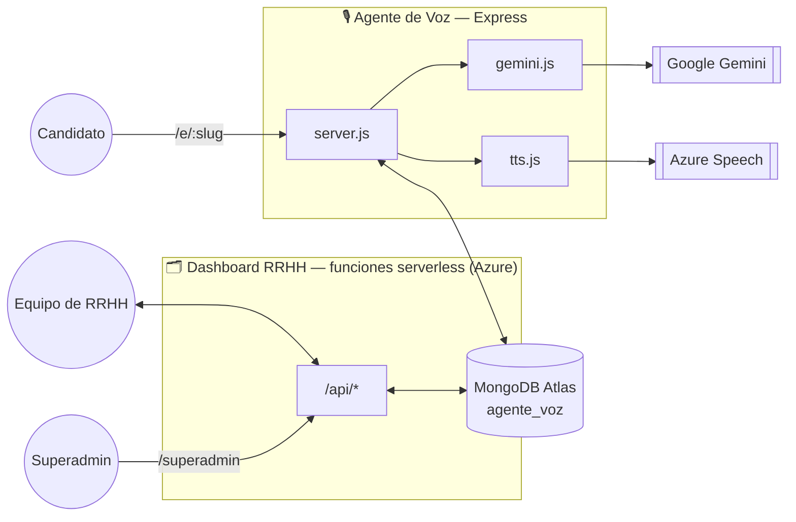
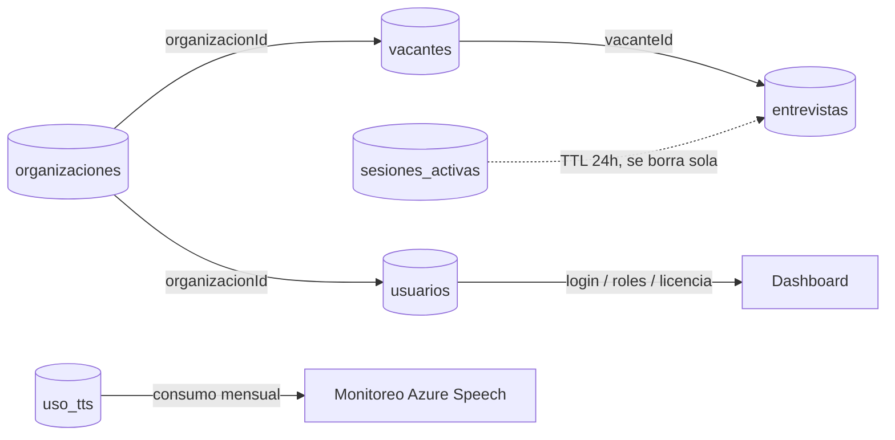
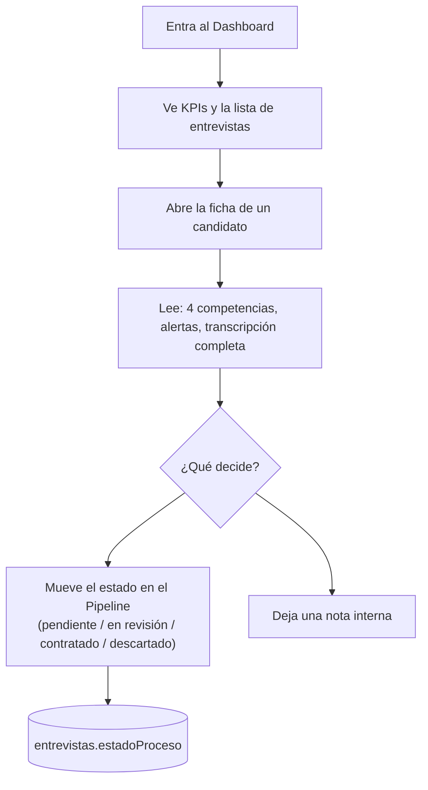

# H-AI-R — Guía de arquitectura

> Documento de referencia interno: cómo están construidas las dos aplicaciones del ecosistema
> H-AI-R, cómo se hablan entre sí, y qué hace cada archivo. Escrito para leerse sin ser
> desarrollador — los diagramas y recorridos van primero, el detalle técnico después.
>
> Este mismo archivo vive espejado en los dos repos (`agente-voz H-AI-R` y `dashboard H-AI-R`)
> porque documenta el ecosistema completo, no solo uno de los dos. Si algo cambia en el código,
> este documento puede quedar desactualizado — ante la duda, el código es la fuente de verdad.

## Contenido

1. [Vista general](#1-vista-general)
2. [La base de datos compartida](#2-la-base-de-datos-compartida)
3. [Multi-tenencia y licencias por usuario](#3-multi-tenencia-y-licencias-por-usuario)
4. [Superadmin — aprovisionar clientes nuevos](#4-superadmin--aprovisionar-clientes-nuevos)
5. [Agente de Voz — Frontend](#5-agente-de-voz--frontend)
6. [Agente de Voz — Backend](#6-agente-de-voz--backend)
7. [El "cerebro": cómo piensa el entrevistador](#7-el-cerebro-cómo-piensa-el-entrevistador)
8. [Dashboard RRHH — Frontend](#8-dashboard-rrhh--frontend)
9. [Dashboard RRHH — Backend](#9-dashboard-rrhh--backend)
10. [Seguridad, sesiones y roles](#10-seguridad-sesiones-y-roles)
11. [Recorrido: una entrevista de principio a fin](#11-recorrido-una-entrevista-de-principio-a-fin)
12. [Recorrido: RRHH revisa un candidato](#12-recorrido-rrhh-revisa-un-candidato)
13. [Pruebas automatizadas y CI](#13-pruebas-automatizadas-y-ci)
14. [Variables de entorno y servicios externos](#14-variables-de-entorno-y-servicios-externos)
15. [Mapa de archivos](#15-mapa-de-archivos)
16. [Glosario](#16-glosario)

---

## 1. Vista general

H-AI-R son **dos aplicaciones separadas** que comparten una sola base de datos. Cada una tiene su
propio código, su propio hosting y su propia audiencia — pero conversan todo el tiempo a través de
MongoDB.

**🎙️ Agente de Voz** — el entrevistador. La cara pública: el candidato entra por el link de su
empresa, elige una vacante, habla, y una IA lo entrevista en tiempo real. Vive en
`agente-voz H-AI-R/`, corre en su propio servidor Express.

**🗂️ Dashboard RRHH** — el panel interno. De uso exclusivo del equipo de RRHH de cada empresa
cliente: gestiona vacantes, revisa entrevistas, mueve candidatos por un pipeline, administra quién
de su equipo tiene acceso. Vive en `dashboard H-AI-R/`, se despliega en Azure a través de
GitHub Actions.

Ninguna de las dos aplicaciones sabe realmente que la otra existe a nivel de código — no se llaman
directamente ni comparten un servidor. Lo único que las conecta es que ambas leen y escriben en las
mismas colecciones de **MongoDB Atlas**. El agente de voz crea entrevistas; el dashboard las lee,
las enriquece con notas y estado de proceso, y administra las vacantes que el agente de voz
consume. Las dos también comparten el mismo concepto de **organización** (ver sección 3): cada
empresa cliente es una organización, y todo lo que cualquiera de las dos apps lee o escribe queda
filtrado por `organizacionId`.



> **Por qué separarlos así:** el candidato nunca necesita (ni debería poder) ver el panel de RRHH,
> y RRHH nunca interactúa con el entrevistador de voz. Mantenerlos como dos aplicaciones
> independientes significa que cada una se puede desplegar, romper o mejorar sin arriesgar a la
> otra.

---

## 2. La base de datos compartida

Todo vive en un solo clúster de MongoDB Atlas, dentro de una base llamada `agente_voz`, con seis
colecciones. Ninguna colección le pertenece a un solo microservicio — ambos leen y escriben según
lo que necesitan.



| Colección | La crea | Para qué sirve |
|---|---|---|
| `organizaciones` | 🗂️ Dashboard (vía superadmin) | Una por cada empresa cliente: nombre, logo, `slug` (el link público del agente de voz, `/e/slug`) y el cupo de licencias contratadas por rol (`licencias.admin`, `licencias.reclutador`). Es el ancla de la multi-tenencia — ver sección 3. |
| `vacantes` | 🗂️ Dashboard | Las posiciones abiertas de cada organización. RRHH las crea/edita/cierra aquí; el agente de voz solo las lee para armar el selector de vacantes y el plan de entrevista. |
| `entrevistas` | 🎙️ Agente de Voz | El resultado final de cada entrevista: transcripción completa, evaluación de la IA (puntaje, 4 competencias, fortalezas), y las alertas antitrampa. El dashboard la lee y le agrega `estadoProceso` y `notas`. |
| `sesiones_activas` | 🎙️ Agente de Voz | Una entrevista *en curso* — se borra sola si el candidato la abandona (índice TTL de 24h) o se elimina a propósito en cuanto termina y ya quedó guardada en `entrevistas`. |
| `usuarios` | 🗂️ Dashboard | Las cuentas del equipo de RRHH que usa el dashboard (no los candidatos). Guarda el rol de cada persona (`admin` o `reclutador`), a qué organización pertenece, y si tiene una licencia asignada — ver sección 3. |
| `uso_tts` | 🎙️ Agente de Voz | Un contador propio de cuántos caracteres se han sintetizado con Azure Speech este mes, para vigilar el límite del plan gratuito. |

---

## 3. Multi-tenencia y licencias por usuario

Cada empresa que contrata H-AI-R es una **organización** (`organizaciones`), y todo lo demás —
vacantes, entrevistas, usuarios del dashboard, incluso el link público que le dan a sus candidatos —
cuelga de ese documento. Ninguna consulta de la API corre sin filtrar por `organizacionId`; es la
frontera que separa los datos de un cliente de los de otro dentro del mismo clúster compartido.

### Cómo llega un candidato a la organización correcta

El agente de voz no tiene selector de empresa: cada organización tiene su propio link,
`/e/:slug`. El cliente lee el slug directo de la URL (no hay router), el servidor lo resuelve
contra `organizaciones.slug`, y desde ahí todo lo que esa sesión crea (la entrevista, el conteo de
`uso_tts`) queda etiquetado con ese `organizacionId`.

### Licencias: quién puede existir vs. quién puede entrar

El modelo es el mismo que usan Microsoft 365 o Azure AD — **crear una cuenta y tener acceso real
son dos cosas separadas**:

- Un admin puede crear tantas cuentas de su equipo como quiera (ex-empleados, cuentas en pausa,
  etc. pueden seguir existiendo sin ocupar un cupo).
- `organizacion.licencias.{admin,reclutador}` es el **cupo contratado** — cuántas cuentas de cada
  rol pueden tener acceso real *al mismo tiempo*, no cuántas pueden existir.
- `usuarios.licenciaAsignada` (booleano) es el interruptor por persona. Asignarla o quitarla es una
  acción explícita del admin desde la pantalla de Usuarios, validada contra el cupo disponible del
  rol de esa persona.
- Sin licencia asignada, el login funciona pero el dashboard entero queda bloqueado detrás de
  `SinLicencia.jsx` — la cuenta puede enterarse de por qué, cerrar sesión o cambiar su contraseña
  (eso queda deliberadamente afuera del bloqueo), pero nada más.

En el servidor, `requireLicencia()` (en `api/_lib/auth.js`) es lo que hace cumplir esto en cada
endpoint de trabajo real, y `requireAdmin()` lo compone — un admin sin licencia tampoco puede
administrar nada.

### Auto-revocación cuando el cupo baja

Si el superadmin reduce el cupo de un rol por debajo de cuánta gente ya tiene licencia asignada, el
sistema no se queda "sobre cupo" esperando a que un humano decida — revoca automáticamente,
empezando por quien tiene la licencia asignada **hace menos tiempo** (`licenciaAsignadaEn`,
descendente), hasta volver a caber. La única garantía dura: nunca se llega a 0 admins licenciados
por esta vía — si hiciera falta quitarle la licencia a todos para caber en el cupo nuevo, se
detiene dejando 1, así ninguna organización se queda sin nadie que pueda entrar a arreglarlo (a
reclutador no le aplica ese piso). El endpoint que hace esto
(`PATCH /api/superadmin/organizaciones/:id`) devuelve a quién le quitó la licencia, y el superadmin
lo ve en un aviso — nunca pasa en silencio.

> **Limitación conocida:** las sesiones son stateless (el rol y la licencia viajan firmados en la
> cookie, sin consultar Mongo en cada petición) — un cambio de licencia o de rol solo se refleja en
> el **próximo login** de esa persona, no al instante. Documentado, no resuelto: resolverlo
> implicaría consultar la base en cada petición autenticada, el costo contrario al que esto existe.

---

## 4. Superadmin — aprovisionar clientes nuevos

Fuera de cualquier organización vive un panel aparte, `/superadmin` en el dashboard, con su propia
sesión completamente separada de la de un usuario normal (otra cookie, otro payload — nunca se
confunden entre sí). No hay usuarios de superadmin con correo/contraseña individual: es una sola
contraseña compartida en `SUPERADMIN_PASSWORD`, igual de simple que los scripts de CLI que
reemplaza (`scripts/crear-organizacion.js`, `scripts/reset-admin-password.js`) — no hay un equipo
de superadmins, es quien opera la plataforma.

Desde ahí se puede:

- **Crear una organización nueva** — nombre, slug, cupo inicial de licencias por rol, y el primer
  admin (con una contraseña temporal que se muestra una sola vez, para compartir por fuera del
  dashboard).
- **Ver el cupo y el uso de licencias de cada organización** de un vistazo (misma barra visual que
  ve un admin en su propio dashboard).
- **Editar el cupo de licencias** de cualquier organización — lo que puede disparar la
  auto-revocación descrita en la sección 3.

---

## 5. Agente de Voz — Frontend

Una sola pantalla que cambia de estado: elegir vacante → entrevista en curso → terminada.
Construida en React + Vite. No hay páginas ni rutas — es una máquina de estados.

### Los 5 estados de la entrevista

Todo `App.jsx` gira alrededor de una variable de estado (`appState`) que solo puede valer una de
estas cinco cosas, y que decide qué animación tiene el orbe y qué botones están activos:

```
idle       → esperando que el candidato toque el orbe
listening  → escuchando (Web Speech API, continuous = true)
thinking   → esperando la respuesta de Gemini
speaking   → leyendo en voz alta la respuesta del entrevistador
done       → entrevista terminada
```

Al entrar a `appState: "listening"` por primera vez, el agente se presenta por voz —se introduce,
explica cómo usar el micrófono y qué va a pasar durante la sesión— antes de que arranque la
entrevista real, encadenado con la pregunta de apertura real para que suene como una sola
conversación fluida, no dos mensajes pegados.

### Hooks — la lógica reutilizable

| Archivo | Qué hace |
|---|---|
| `useSpeechRecognition.js` | Micrófono → texto (STT), usando la Web Speech API del navegador. Escucha sin parar hasta que el candidato vuelve a tocar el orbe — no corta por pausas cortas. |
| `useSpeechSynthesis.js` | Texto → voz (TTS): intenta primero Azure Speech vía el servidor, y cae al sintetizador del navegador si Azure no está disponible. |
| `useTabVisibility.js` | Cuenta en silencio cuántas veces el candidato cambió de pestaña/ventana durante la entrevista — la señal antitrampa que ve RRHH después. |
| `useTheme.js` | Tema claro/oscuro, recordado entre sesiones. |

### Componentes visuales

`VacanteSetup` (elegir vacante + cédula/celular + aviso de privacidad) → `Orb` (el orbe animado,
con una cara amigable y estados visuales propios, que cambia según si está escuchando, pensando o
hablando) + `ProgressBar` + `VoiceBar` (controles) durante la entrevista.

---

## 6. Agente de Voz — Backend

Un servidor Node/Express clásico (no serverless): guarda las API keys, mantiene las sesiones de
entrevista en memoria mientras corre, y es el único que le habla directamente a Gemini y a Azure
Speech.

| Endpoint | Qué hace |
|---|---|
| `GET /api/vacantes` | Lista las vacantes abiertas de la organización del slug, para el selector. |
| `POST /api/session` | Crea la entrevista: genera el plan de preguntas, arma el chat con Gemini, y la IA abre la conversación sola. |
| `POST /api/message` | Recibe la respuesta hablada (ya transcrita) y devuelve la siguiente pregunta o el cierre. |
| `POST /api/tts` | Convierte texto a audio con Azure Speech. |
| `GET /api/tts/uso` | Consumo del mes contra el límite gratuito de Azure. |

Los cuatro endpoints que más se podrían abusar (`session`, `message`, `tts`, `vacantes`) tienen
**rate limiting por IP** (`express-rate-limit`) — pensado para frenar un script automatizado
disparando cientos de peticiones por minuto, no para limitar a un grupo real de candidatos
entrevistándose a la vez desde la misma oficina (los límites son generosos a propósito).

### Los 5 archivos que hacen el trabajo pesado

| Archivo | Responsabilidad |
|---|---|
| `server.js` | Define los endpoints, resuelve la organización por slug, guarda las sesiones en un `Map` en memoria (con respaldo en Mongo por si el servidor se reinicia), aplica el rate limiting, y decide cuándo forzar el cierre de la entrevista. |
| `gemini.js` | Todo lo que habla con Google Gemini: genera el plan de preguntas, arma las instrucciones del entrevistador, y evalúa la entrevista al final. |
| `entrevistaLogica.js` | Reglas de negocio puras (sin dependencias externas, 100% testeables): cuándo cerrar la entrevista, cómo calcular el puntaje global, cuándo marcar "aprobado". |
| `tts.js` | Llama a Azure Speech y arma el SSML (el XML que describe cómo debe sonar la voz, incluyendo pausas naturales después de cada oración). |
| `db.js` | Todas las lecturas/escrituras a MongoDB — es la única pieza que sabe el nombre de las colecciones. |

---

## 7. El "cerebro": cómo piensa el entrevistador

Gemini nunca improvisa desde cero — cada entrevista tiene un guion generado a la medida de la
vacante, y una evaluación final que sigue una rúbrica fija en vez de un juicio libre.

**1. Se genera un plan de preguntas por vacante.** `generarPlanEntrevista()` le manda a Gemini la
descripción y los requisitos reales de la vacante (no el título solo) y le pide entre 12 y 20
preguntas de perfilamiento. Siempre se le antepone una pregunta fija de presentación personal, y
se recorta a máximo 20 técnicas.

**2. Se arma el `systemInstruction` del entrevistador.** Con ese plan, `crearChatEntrevista()` le
da a Gemini un rol completo: la lista exacta de preguntas en orden, el tono (cercano en la primera,
técnico después), cuándo y cómo cerrar, y —la parte antitrampa— instrucciones para repreguntar
pidiendo un ejemplo concreto cuando una respuesta suena demasiado genérica o ensayada, como si
viniera de otra IA o de una búsqueda en internet.

**3. Al terminar, se evalúa en 4 ejes — no un solo número.** `evaluarEntrevista()` le pide a Gemini
calificar por separado **conocimiento técnico**, **comunicación**, **resolución de problemas** y
**fit con el rol** (0–100 cada uno). El puntaje global que ve RRHH *nunca* se le pregunta a la IA
directamente — se calcula en código como el promedio de los cuatro, para que sea siempre
consistente y explicable.

> **Por qué separarlo así:** si alguna vez alguien pregunta "¿por qué la IA rechazó a este
> candidato?", la respuesta está en los 4 números, no en una caja negra.

**4. Dos señales antitrampa viajan junto con la evaluación:**

- **Cambios de pestaña/ventana** — contados en el navegador (`useTabVisibility`), en silencio, sin
  avisarle al candidato.
- **Posible uso de IA** — el propio Gemini revisa, al evaluar, si las repreguntas del punto 2
  lograron sacar un ejemplo real o si el candidato se quedó en respuestas genéricas.

Ninguna de las dos cambia el veredicto automáticamente — quedan guardadas como `alertas` para que
un humano las revise en el dashboard.

---

## 8. Dashboard RRHH — Frontend

Una aplicación de varias páginas de verdad (con rutas), construida en React + React Router. Nadie
entra sin loguearse primero.

| Página | Para qué es |
|---|---|
| `DashboardHome` | KPIs generales y la lista filtrable de entrevistas. |
| `InterviewDetail` | Ficha completa de un candidato: transcripción, evaluación por competencias, alertas, notas de RRHH. |
| `Pipeline` | Tablero Kanban — arrastra candidatos entre pendiente / en revisión / contratado / descartado. |
| `VacantesList / VacanteDetail / VacanteNueva` | CRUD completo de vacantes. |
| `Usuarios` | Gestión del equipo: agregar personas, asignar/quitar licencias, resetear contraseñas, y la marca (nombre/logo) de la organización. |
| `Login / CambiarPasswordForzado` | Acceso, y la pantalla obligatoria tras una contraseña temporal (reseteo de emergencia por CLI, o el primer login de una organización recién creada). |
| `SinLicencia` | Pantalla bloqueante para una cuenta autenticada pero sin licencia asignada — ver sección 3. |
| `Superadmin` | Panel aparte, fuera de cualquier organización — ver sección 4. |

---

## 9. Dashboard RRHH — Backend

A diferencia del agente de voz, este backend no es un servidor que corre todo el tiempo — es un
conjunto de **funciones independientes** bajo `/api` que Azure enciende solo cuando alguien las
llama. En desarrollo local, un plugin de Vite (`local-api.js`) simula ese mismo comportamiento sin
depender de ninguna CLI de despliegue.

| Recurso | Endpoints |
|---|---|
| Autenticación | `POST /api/auth/login` · `/logout` · `/me` · `/cambiar-password` |
| Entrevistas | `GET /api/entrevistas` (lista + filtros) · `GET/PATCH /api/entrevistas/:id` · `/export` (CSV) |
| Vacantes | `GET/POST /api/vacantes` · `GET/PUT/DELETE /api/vacantes/:id` · `/export` |
| Usuarios | `GET/POST /api/usuarios` · `PATCH /api/usuarios/:id` (`resetPassword` / `asignarLicencia` / `quitarLicencia`) |
| Organización | `PATCH /api/organizacion` — nombre para mostrar y logo |
| Estadísticas | `GET /api/stats` — KPIs agregados para el home |
| Superadmin | `POST /api/superadmin/login` · `/logout` · `/me` · `GET/POST /api/superadmin/organizaciones` · `PATCH /api/superadmin/organizaciones/:id` |

`api/_lib/` guarda todo lo compartido entre esas funciones: conexión a Mongo, autenticación y
licencias, CORS, construcción de filtros, exportación a CSV, y rangos de fechas.

Cada función queda envuelta en `conCors()` (`api/_lib/cors.js`): mientras el frontend y la API
sirvan del mismo origen (como hoy) el navegador ni pregunta, pero si alguna vez el dashboard y su
API terminan en subdominios distintos, o el agente de voz necesita llamar a esta API, la lista de
orígenes permitidos se controla por variable de entorno (`CORS_ALLOWED_ORIGINS`) en vez de quedar
implícitamente abierta a cualquiera.

---

## 10. Seguridad, sesiones y roles

### Cómo funciona el login (sin librerías externas)

Las contraseñas se guardan con `scrypt` (nativo de Node, nunca en texto plano). Al iniciar sesión,
el servidor arma un token firmado —payload + firma HMAC-SHA256— y lo guarda en una cookie
`HttpOnly` (JavaScript del navegador no puede leerla, así que un ataque XSS no puede robarla). El
servidor nunca "recuerda" quién está logueado — cada petición trae su propia prueba firmada.

### Dos roles, y una licencia que los habilita a ambos

| Rol | Puede | No puede |
|---|---|---|
| `admin` | Todo — vacantes, entrevistas, pipeline, gestionar el equipo y sus licencias, la marca de la organización. | — |
| `reclutador` | Ver y gestionar entrevistas/pipeline/vacantes. | Agregar personas al equipo, gestionar licencias, resetear contraseñas, ni borrar vacantes — el servidor lo bloquea aunque alguien intente llamar al endpoint directo. |

Ninguno de los dos puede hacer nada de esto sin tener, además, una **licencia asignada** (ver
sección 3) — el rol dice qué podría hacer una cuenta, la licencia dice si esa cuenta tiene acceso
real en este momento.

### Restablecer la contraseña de alguien del equipo

Un admin le escribe la contraseña nueva directamente a la persona desde la pantalla de Usuarios —
no una clave temporal generada al azar que hay que leer y transcribir bien. Queda activa de
inmediato, pensada para comunicarse por fuera del dashboard (WhatsApp, en persona). La única vía
que sigue generando una contraseña **temporal** (con cambio obligatorio en el próximo login) es la
de emergencia: el primer admin de una organización recién creada, o un reseteo por CLI
(`scripts/reset-admin-password.js`) cuando no hay ninguna sesión de admin disponible para hacerlo
desde la pantalla.

---

## 11. Recorrido: una entrevista de principio a fin

1. **Elige vacante y acepta el aviso de privacidad.** Escribe cédula y celular a mano — por voz un
   error de transcripción pesa demasiado.
2. **El servidor arma el plan y abre la conversación.** `POST /api/session` genera las preguntas
   con Gemini y la IA se presenta y explica el uso del micrófono antes de saludar con la pregunta
   de apertura real.
3. **El candidato habla, turno por turno.** Cada respuesta transcrita va a `POST /api/message`;
   Gemini repregunta si algo suena ensayado.
4. **El sistema registra las señales antitrampa en silencio.** Cambios de pestaña se acumulan en
   el navegador y viajan con cada mensaje.
5. **Se cierra la entrevista.** Porque Gemini lo decidió solo, o porque el servidor fuerza el
   cierre tras el margen de seguridad.
6. **Se evalúa y se guarda.** 4 competencias + posible uso de IA + puntaje global calculado en
   código → colección `entrevistas`.
7. **Aparece en el Dashboard.** Lista, Pipeline y ficha de detalle — lista para que RRHH decida.

---

## 12. Recorrido: RRHH revisa un candidato



El veredicto de la IA (`aprobado`) y el estado real del proceso (`estadoProceso`) son campos
**independientes** a propósito — la IA da una señal, la decisión final siempre es humana.

---

## 13. Pruebas automatizadas y CI

Ambos repos corren sus tests en GitHub Actions en cada push y pull request a `main`
(`.github/workflows/test.yml` en cada uno) — todavía no incluye el despliegue en sí, que queda
pendiente de armar cuando se decidan los detalles concretos del lado de Azure.

| Repo | Framework | Qué cubre |
|---|---|---|
| 🎙️ Agente de Voz | Jest (`server/*.test.js`) | `entrevistaLogica.js` (reglas puras), `db.js`, `gemini.js`, `tts.js` — todo con dobles de Mongo/Gemini/Azure, nunca contra servicios reales. |
| 🗂️ Dashboard RRHH | Vitest (`api/**/*.test.js`) | `api/_lib/auth.js` (hash/verificación de contraseñas, firma y verificación de tokens, las cuatro puertas `requireAuth`/`requireLicencia`/`requireAdmin`/`requireSuperAdmin`), `api/_lib/cors.js`, y la lógica de licencias de `api/usuarios/[id].js` y `api/superadmin/organizaciones/[id].js` (incluida la auto-revocación del más reciente al más antiguo). |

Ninguno de los dos test suites necesita credenciales reales — todo lo que normalmente hablaría con
Mongo, Gemini o Azure Speech queda reemplazado por un doble de prueba, así que corren igual de bien
en una laptop que en un runner de GitHub sin secretos configurados.

---

## 14. Variables de entorno y servicios externos

Cada servicio externo tiene su propia llave, y cada llave vive solo del lado del servidor — nunca
en el código del navegador.

| Variable | Servicio | Vive en |
|---|---|---|
| `GEMINI_API_KEY` | Google Gemini — el modelo que entrevista y evalúa | 🎙️ Agente de Voz |
| `AZURE_SPEECH_KEY` / `AZURE_SPEECH_REGION` | Azure AI Speech — voz natural (TTS) | 🎙️ Agente de Voz |
| `MONGODB_URI` | MongoDB Atlas — la base de datos compartida | Ambos |
| `SESSION_SECRET` | Firma las cookies de sesión de usuarios del dashboard | 🗂️ Dashboard |
| `SUPERADMIN_PASSWORD` | La única contraseña del panel de superadmin | 🗂️ Dashboard |
| `CORS_ALLOWED_ORIGINS` | Lista separada por comas de orígenes autorizados a llamar a la API desde otro dominio (ver sección 9) | 🗂️ Dashboard |

---

## 15. Mapa de archivos

### 🎙️ Agente de Voz

```
server/
  server.js            endpoints Express, rate limiting, resolución de organización por slug
  gemini.js            plan, chat, evaluación (Gemini)
  entrevistaLogica.js  reglas puras + tests
  tts.js               Azure Speech
  db.js                acceso a MongoDB
client/src/
  App.jsx              máquina de estados de la entrevista
  hooks/               useSpeechRecognition, useSpeechSynthesis,
                        useTabVisibility, useTheme
  components/          Orb, VacanteSetup, ProgressBar, VoiceBar…
.github/workflows/     CI: tests del servidor + build del cliente
```

### 🗂️ Dashboard RRHH

```
api/
  _lib/                auth (sesiones + licencias), mongodb, cors,
                        filtros, csv, fechas — compartido
  auth/, usuarios/,
  entrevistas/, vacantes/, superadmin/,
  organizacion.js, stats.js           un archivo = un endpoint
src/
  pages/               una por pantalla: incluye Superadmin y SinLicencia
  components/          piezas reusables: Select, Toggle, LicenciaBarra,
                        ScoreBadge, CompetencyMeters…
  lib/api.js           todas las llamadas fetch en un solo lugar
scripts/               CLI de emergencia/operación: crear-organizacion,
                        reset-admin-password, migraciones puntuales
.github/workflows/     CI: lint + tests + build
```

---

## 16. Glosario

- **Endpoint** — Una URL del servidor que hace algo específico cuando la llamas (ej. "crear una
  entrevista").
- **Función serverless** — Código que solo "se enciende" cuando alguien lo llama, en vez de un
  servidor prendido 24/7. Así funciona todo el backend del dashboard.
- **Multi-tenencia** — Varias organizaciones (clientes) comparten la misma base de datos y el mismo
  código, pero cada una solo ve sus propios datos — ver sección 3.
- **Licencia (por usuario)** — El interruptor de acceso real de una cuenta, separado de si la
  cuenta existe. El cupo de licencias es lo que la organización contrató; asignarla o no es una
  decisión del admin, persona por persona.
- **CORS** — La regla del navegador que decide si una página de un dominio puede llamar a la API de
  otro. Por defecto lo prohíbe; `CORS_ALLOWED_ORIGINS` es la lista explícita de excepciones.
- **systemInstruction** — El "guion de personaje" que se le da a Gemini antes de la conversación:
  quién es, qué preguntas hace, cómo debe comportarse.
- **Hook (React)** — Un pedazo de lógica reutilizable (ej. "escuchar el micrófono") que un
  componente puede usar sin reescribirla.
- **Cookie HttpOnly** — Una cookie que el JavaScript del navegador no puede leer — solo viaja
  automáticamente en cada petición al servidor. Protege la sesión de robos por XSS.
- **Hash (contraseñas)** — Una transformación de un solo sentido: se puede verificar una
  contraseña sin jamás guardarla en texto plano.
- **TTL (Mongo)** — "Time To Live": un índice que borra documentos solo después de cierto tiempo,
  sin que nadie tenga que hacerlo a mano.
- **Rol / RBAC** — Control de acceso basado en roles: qué puede hacer cada tipo de cuenta (admin
  vs. reclutador), reforzado tanto en la pantalla como en el servidor.
- **CI (integración continua)** — Correr automáticamente los tests (y el build) en cada cambio
  subido a GitHub, antes de que llegue a nadie más — ver sección 13.
